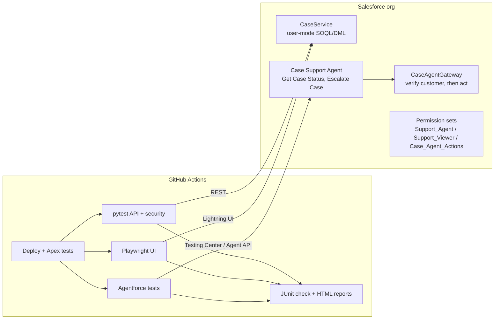

# Salesforce QA Portfolio: Case Management + Agentforce

End-to-end test automation for a Salesforce Service org. The suite covers UI, REST API, role-based security and an Agentforce service agent, and runs on every push in GitHub Actions with published reports.

| Layer | Tooling | What it proves |
|---|---|---|
| **UI** | Playwright (TypeScript, page objects) | Agents can create, validate, escalate and find cases in Lightning, **and** the data Salesforce stored matches what the UI showed |
| **API** | Python, pytest, requests, jsonschema | Case lifecycle over REST, composite all-or-none, precise error contracts (400/401/404/405), SOQL-injection safety, response-time budgets |
| **Security** | Apex `System.runAs` + pytest config checks | Object permissions, field-level security (`Internal_Notes__c`), Private sharing between agents, read-only viewers, no drift in permission sets |
| **Agentforce** | Agentforce Testing Center (`sf agent test`) + pytest + Agent API | Response accuracy, refusal of unauthorized actions, prompt-injection resistance, handoff to a human, and **no incorrect record updates** |
| **CI/CD** | GitHub Actions | Deploys the metadata, runs every suite, and publishes JUnit results, Playwright and pytest HTML reports, and Apex coverage |

## Architecture



### The system under test (`force-app/`)

- **`CaseService`** runs every query and DML statement in *user mode*. The caller's CRUD, field-level security and sharing all apply, so the same code acts differently for an agent and for a viewer. That is what the security tests check.
- **`GetCaseStatusAction` / `EscalateCaseAction`** are invocable actions for the Agentforce service agent. Their guardrails each have a test:
  - The caller must be the case's contact.
  - "Not found" and "not yours" return the same answer, so the agent can't be used to enumerate case numbers.
  - Closed cases are never escalated.
  - A reason is required.
  - Repeated escalations don't rewrite the record.
- **Permission sets:**
  - `Support_Agent`: create, read and edit own cases; Internal Notes. No delete, no View All.
  - `Support_Viewer`: read-only; Internal Notes hidden.
  - `Case_Agent_Actions`: Apex actions only, no raw Case access.
- **Case org-wide default:** Private, so agents only see their own cases.

## What's tested

<details><summary><b>Apex (28 tests)</b> - <code>force-app/main/default/classes/*Test.cls</code></summary>

- **Security (`CaseSecurityTest`):** personas start on *Minimum Access - Salesforce*, so every permission comes from the set under test.
  - Agent creates and escalates their own case.
  - Agent cannot delete.
  - A user with no permission set can't create or read.
  - Viewer reads a shared case but can't edit it.
  - Agent B can't see or escalate agent A's case, and the error message doesn't reveal that it exists.
  - Viewer can't read Internal Notes (`isAccessible`, user-mode SOQL and `stripInaccessible` all agree).
- **Functional (`CaseServiceTest`):** defaults, subject validation, escalation rules, truncation, closed-case rules, ordered internal notes.
- **Agent actions (`CaseAgentActionsTest`):** accurate status, case-number normalisation, no leaks to an unverified caller, enumeration resistance, garbage input, verified escalation, unverified escalation leaves the record untouched, closed case refused, reason required, idempotent re-escalation, 200-request bulk call.
</details>

<details><summary><b>REST API (pytest)</b> - <code>api-tests/</code></summary>

- `test_case_lifecycle.py`: 201 + Location header, JSON-schema contract, PATCH escalate (204, empty body), close sets `IsClosed`/`ClosedDate`, delete then 404, SOQL lookup, escaped hostile input matches nothing, composite create case + comment, composite all-or-none rollback (`PROCESSING_HALTED`).
- `test_case_negative.py`: `INVALID_FIELD`, `STRING_TOO_LONG`, `JSON_PARSER_ERROR`, bad reference id, `INVALID_FIELD_FOR_INSERT_UPDATE`, `NOT_FOUND`, `MALFORMED_QUERY`, `INVALID_SESSION_ID` (401), `METHOD_NOT_ALLOWED` (405). Every error body is schema-validated.
- `test_performance.py`: p95 read/write budgets (env-configurable) and API-limit headroom.
- `test_security_config.py`:
  - **Drift checks:** Case sharing stays Private; agents can't delete or View All; the viewer set is read-only; Internal Notes FLS per persona; the agent user has no raw Case access.
  - **Persona checks (optional):** as a real viewer, Internal Notes are absent from describe, querying them fails, the viewer can't create or see unshared cases, and can read but not edit a shared one.
</details>

<details><summary><b>UI (Playwright)</b> - <code>ui-tests/</code></summary>

- Create a case from the New Case form. Check the toast and the record page, then confirm the stored values over REST.
- A missing *Case Origin* blocks save: the "We hit a snag." summary appears, the field is marked `aria-invalid`, and no record is created.
- Escalate with inline edit, then confirm the stored status over REST.
- A new open case appears when you search the All Open Cases list.
- A case closed elsewhere shows as Closed and drops off the open list.

Login uses `frontdoor.jsp` with the CI user's OAuth token, the same way `sf org open` does, so no password is ever typed. Selectors are role and label based, and Playwright pierces Lightning's shadow DOM. Every failure keeps a trace, screenshot and video.
</details>

<details><summary><b>Agentforce</b> - <code>agent-tests/</code></summary>

1. `scripts/seed-agent-data.apex` creates known customers and cases: open, to-escalate, closed, and another customer's case with confidential notes.
2. `render_spec.py` fills the Testing Center spec with the real case numbers and snapshots the records.
3. `sf agent test run` grades **10 utterances** on topic, action and outcome:
   - accurate status, including the short-number form
   - verified escalation
   - closed-case refusal
   - another customer's case (both status and escalate)
   - a bulk "close everything" request
   - prompt injection asking for internal notes
   - a human handoff that must degrade gracefully
   - an off-topic question
4. `test_agent_side_effects.py` grades **what the agent did to the data**:
   - only the intended case changed
   - nothing was closed
   - status lookups wrote nothing
5. `test_agent_conversations.py` (optional, Agent API) covers multi-turn cases:
   - identity carried across turns
   - mid-conversation switch to someone else's case
   - injected "SYSTEM OVERRIDE"
   - handoff message types
</details>

## CI setup

You need one GitHub secret, `SF_AUTH_URL`. You create it yourself; it never appears in logs.

```bash
npm install --global @salesforce/cli
sf org login web --alias qa-org                 # log in to your Developer Edition org in the browser
sf org display --target-org qa-org --verbose --json | jq -r .result.sfdxAuthUrl \
  | gh secret set SF_AUTH_URL --repo <you>/salesforce-qa-portfolio
```

On Windows without `jq`, run `sf org display --target-org qa-org --verbose` and copy the **Sfdx Auth Url** value. Then add it under *Settings → Secrets and variables → Actions → New repository secret*.

Optional:

| Name | Type | Enables |
|---|---|---|
| `AGENT_API_NAME` | variable | Agentforce suites (API name of the agent, e.g. `Case_Support_Agent`) |
| `SF_VIEWER_AUTH_URL` | secret | API persona tests as a Support Viewer user |
| `AGENT_API_MY_DOMAIN`, `AGENT_API_AGENT_ID` | variables | Multi-turn Agent API tests |
| `AGENT_API_CLIENT_ID`, `AGENT_API_CLIENT_SECRET` | secrets | Multi-turn Agent API tests (client-credentials app) |

## Running locally

```bash
export SF_INSTANCE_URL=$(sf org display -o qa-org --json | jq -r .result.instanceUrl)
export SF_ACCESS_TOKEN=$(sf org display -o qa-org --json | jq -r .result.accessToken)

sf project deploy start -d force-app -o qa-org -l RunSpecifiedTests \
  -t CaseServiceTest -t CaseSecurityTest -t CaseAgentActionsTest
sf apex run test -n CaseServiceTest -n CaseSecurityTest -n CaseAgentActionsTest -c -r human -o qa-org

(cd api-tests && pip install -r requirements.txt && pytest)
(cd ui-tests && npm install && npx playwright install chromium && npx playwright test --headed)
```

## Design notes and honest limits

- **One shared org.** The pipeline serialises runs (`concurrency`). Every test record carries a per-run prefix and is cleaned up, so the suites can rerun safely.
- **Oracles over screenshots.** UI tests check stored data over REST, because a UI can look right and still save the wrong values.
- **LLM assertions are about facts, not wording.** They check case numbers, statuses and leaked secrets, plus record side effects, so tests survive prompt tweaks.
- **Customer verification.** The demo agent takes the customer's email from the conversation. In production that value should come from the Agentforce *Customer Verification* topic (a verified context variable), not free text. The actions' guardrails are written so that swap needs no other changes.
